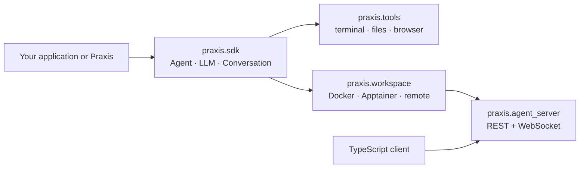

# Architecture

Praxis SDK is a `uv` workspace of four Python packages plus a TypeScript client.
Each package can be used on its own, but they share one event model so the same
agent definition runs in-process, in a container or behind a remote server.



| Package               | Source directory                                       | Responsibility                                                                  |
| --------------------- | ------------------------------------------------------ | ------------------------------------------------------------------------------- |
| `praxis-sdk`          | [`praxis-sdk/`](../../praxis-sdk/)                     | Agent loop, LLM abstraction, conversations, events, skills, hooks, security     |
| `praxis-tools`        | [`praxis-tools/`](../../praxis-tools/)                 | Built-in tools and presets such as `get_default_agent`                          |
| `praxis-workspace`    | [`praxis-workspace/`](../../praxis-workspace/)         | Sandboxed workspaces: `DockerWorkspace`, Apptainer, Agent Sandbox, remote API   |
| `praxis-agent-server` | [`praxis-agent-server/`](../../praxis-agent-server/)   | Server that hosts conversations, files, terminals and settings over HTTP        |
| TypeScript client     | [`clients/typescript/`](../../clients/typescript/)     | Browser-compatible client for remote conversations                              |

## Namespaces

The public namespace is `praxis.*`:

```python
from praxis.sdk import Agent, Conversation, LLM
from praxis.tools.terminal import TerminalTool
from praxis.workspace import DockerWorkspace
```

Historical `openhands.*` imports resolve to the same module objects, so existing code
and serialized conversations keep working. See [Compatibility identifiers](../reference/compatibility.md).

## Event model

Every interaction is an immutable event: user messages, LLM actions, tool
observations, state updates and errors. A conversation is an append-only event log
that can be persisted, replayed, streamed over WebSocket and forked.
